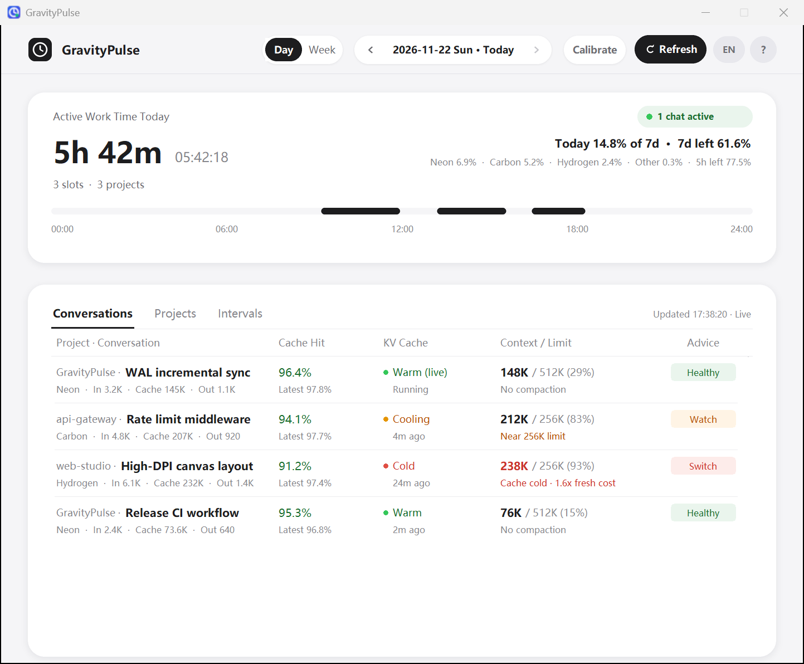
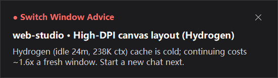

# GravityPulse

[English](README.md) | [简体中文](README_ZH.md)

A lightweight, local-only desktop monitor for **Antigravity 2.0** (Windows 10/11 & macOS). It tracks effective coding time, calibrates 7-day / 5-hour rolling quota usage, and monitors per-conversation implicit KV cache warmth so you know when to open a fresh window instead of burning quota on cold recomputation.

> **Disclaimer**: GravityPulse is an unofficial, read-only community tool. It reads local telemetry files under `~/.gemini/antigravity`, requires no API keys, intercepts no network traffic, and uploads nothing. Because Antigravity's internal local storage schema may change in future updates, adjustments may occasionally be needed.

https://github.com/user-attachments/assets/75b27007-e8b0-4ba2-b9fb-881ebf9f5a21

<p align="center">
  
</p>

<p align="center">
  
</p>

---

## Why GravityPulse

When working heavily with Antigravity 2.0, three questions come up constantly: how much of your 7-day and 5-hour rolling quota is left, whether a paused conversation's implicit KV cache has already cooled down (making a fresh window cheaper than continuing), and how much active time you actually spent across parallel windows and worktrees. GravityPulse reads local SQLite WAL files and transcripts directly in the background to answer all three without interrupting your workflow.

## Key Features

- **7-Day & 5-Hour Rolling Quota Tracking**: Calibrates against your official quota panel in one dialog (including 7-day reset countdown alignment and customizable `Carbon` / `Neon` multipliers, calibrated at `3.5x` / `1.75x` by default), tracks remaining 7-day cycle and 5-hour rolling budgets, and breaks down consumption by model (`Carbon`, `Neon`, `Hydrogen`, `Other`), project, time interval, and day.
- **Phase-Aware & Project-Adaptive Switch Advisor**: Learns per-model KV cache survival curves and per-(project, model) recent 10-dialog warmup costs to derive EOQ pause-switch thresholds. Stays quiet while an agent is actively editing or verifying, nudges once on natural pauses (idle, awaiting input, or waiting on a background build), fires an urgent safeguard only near 512K compaction (`400K` / `430K` / `450K`), and mutes automatically during handover turns.
- **Subagent & Swarm Worker Hierarchy**: Displays active and recent subagents / Swarm workers indented beneath their parent conversation with reuse guidance, tracks parent KV cache decay while subtasks run, and prevents false cold-cache popups.
- **Accurate Active Work Time**: Uses explicit user messages to define session bounds (30-minute idle bridge, extended to 60 minutes while an agent task is actively running, with zero unattended tail after your last prompt), automatically merging subagents and Git worktrees into parent projects.
- **Non-Intrusive Residency & Local Ledger**: Runs silently in the Windows system tray or macOS menu bar with non-activating bottom-right alerts (`WS_EX_NOACTIVATE` / macOS floating overlay) and a local incremental ledger (`data/telemetry_ledger.db`, or `~/Library/Application Support/GravityPulse/` for macOS `.app`) so deleting chats never erases history.
- **Built-In Cross-Platform Updater & Bilingual UI**: Optional GitHub Releases update checker with safe in-place updates (Win64 packaged swap preserving `data/`, macOS `.dmg` download & open, and Git dirty-worktree protection for source checkouts), plus instant English / 简体中文 switching.

---

## Platform & Requirements

- **OS**:
  - **Windows 10 / 11**: Native Win32 system tray, `WS_EX_NOACTIVATE` silent popups, and HKCU startup watcher.
  - **macOS 12+ (Apple Silicon, Beta)**: Native top menu bar icon (`NSStatusBar`), Retina-scaled UI, non-activating floating alerts, and `LaunchAgent` auto-start.
- **Runtime (from source)**: Python 3.11+ (standard `tkinter`, `sqlite3`) with `Pillow` (and `pyobjc-framework-Cocoa` on macOS, installed via `requirements.txt`).

---

## Quick Start

### Option 1: Prebuilt Releases (No Python Required)

**Windows**:
1. Download `GravityPulse-win64.zip` from the [Releases](../../releases) page.
2. Extract it to a folder of your choice and double-click `GravityPulse.exe` (because the binary is unsigned, click **More info → Run anyway** if Windows SmartScreen prompts).
3. Right-click the tray icon to toggle **Auto-start with Antigravity**, **Create Desktop Shortcut**, or switch language.

**macOS (Apple Silicon, Beta)**:
1. Download `GravityPulse-macos-arm64.dmg` from the [Releases](../../releases) page, open it, and drag **GravityPulse.app** into **Applications**.
2. Because the open-source `.app` is not notarized with an Apple Developer certificate, clear the quarantine attribute once before the first launch:
   ```bash
   xattr -cr /Applications/GravityPulse.app
   ```
3. Launch **GravityPulse** from Applications. Click the clock icon in the top macOS menu bar to toggle **Auto-start with Antigravity** (`LaunchAgent`), create a Desktop shortcut, or switch language.

### Option 2: Run from Source

```bash
git clone https://github.com/aodilab/GravityPulse.git
cd GravityPulse
pip install -r requirements.txt

# Launch or focus the GravityPulse dashboard
python build.py

# Optional: generate icons, Desktop shortcut, and auto-start companion watcher
python build.py --setup
```

### First-Time Quota Calibration

Click the quota calibration button in the top bar and enter the current remaining/used percentage shown in your Antigravity Quota panel. GravityPulse stores your calibration locally in `data/quota_config.json` and continuously updates both rolling windows from local telemetry.

---

## CLI Commands

| Command | Description |
| --- | --- |
| `python build.py` | Launch or focus the GravityPulse desktop window |
| `python build.py --background` | Start hidden directly in the Windows system tray |
| `python build.py --watch` | Run the singleton companion watcher that auto-starts GravityPulse when `Antigravity.exe` opens |
| `python build.py --setup` | Generate `assets/gravitypulse.ico`, create Desktop `GravityPulse.lnk`, and register HKCU startup |
| `python build.py --uninstall-startup` | Remove the HKCU startup entry |
| `python build.py --update` | Check GitHub Releases and safely update (preserves `data/`, guards dirty Git trees) |
| `python build.py --test` | Run the unit test suite |
| `python build.py --audit` | Run line-budget check, syntax check, and full unit tests |

---

## Build Locally (`.exe` / `.app`)

```bash
pip install pyinstaller
python build.py --icon
pyinstaller --noconfirm --clean packaging/gravitypulse.spec
```

Outputs `dist/GravityPulse/` on Windows and `dist/GravityPulse.app` on macOS.

---

## Project Structure

```text
GravityPulse/
├── build.py                      # Unified CLI entrypoint
├── config/settings.py            # Paths, pricing constants, cache thresholds, and UI tokens
├── src/
│   ├── core/                     # WAL/Protobuf decoding, ledger, sessionizer, quota, advisor, watcher
│   └── ui/                       # Pillow supersampled primitives, Win32 tray, incremental canvas views, modals
├── scripts/                      # Multi-size ICO builder, shortcut helper, and audit runner
├── packaging/gravitypulse.spec   # PyInstaller portable Windows spec
├── tests/                        # Unit test suite
└── assets/                       # Application icon
```

## Privacy & Security

- **100% Local Processing**: Reads `~/.gemini/antigravity` in read-only mode and stores runtime config/ledger only inside the local `data/` directory (or `~/Library/Application Support/GravityPulse/` on macOS `.app`).
- **Zero Telemetry Uploads**: GravityPulse never uploads workspace data, logs, or usage metrics. The only optional outbound request is checking `api.github.com` for new GitHub Releases, which can be disabled in Settings.

## License

[MIT](LICENSE)
