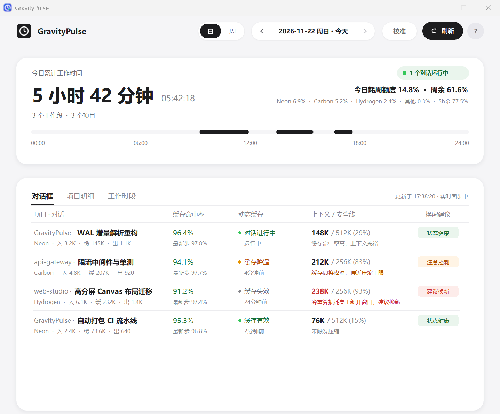
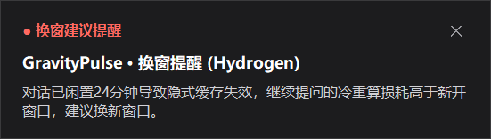

# GravityPulse

[English](README.md) | [简体中文](README_ZH.md)

面向 **Antigravity 2.0** 的 Windows 本地桌面监控，查看有效工时、双滚动额度和隐式 KV 缓存状态。

高频使用时，很难直观判断 7 天和 5 小时额度还剩多少，也难看出旧对话缓存有没有失效。GravityPulse 只读本地数据库与日志，不填 API Key，不上传数据。

- **滚动额度**：对照官方 Quota 面板校准，实时估算 7 天与 5 小时余量，按模型和项目拆分消耗。
- **换窗提示**：基于本地历史学习缓存存活时间，换新更划算时在右下角弹出无焦点静音卡片。
- **有效工时**：按用户发消息界定会话，归并子代理与 Worktree，本地账本留存历史记录。

> **免责声明**：GravityPulse 是非官方社区开源工具，仅以只读方式解析 `~/.gemini/antigravity` 下的本地文件。若官方后续调整本地存储结构，可能需要同步适配。

<p align="center">
  
</p>

<p align="center">
  
</p>

---

## 支持平台与运行边界

- **操作系统**：当前仅支持 Windows 10 / 11（托盘、无焦点提醒与伴随自启依赖 Win32 API，欢迎社区提交 macOS / Linux 适配 PR）。
- **源码环境**：Python 3.11+（标准库 `tkinter`、`sqlite3`、`ctypes`），第三方依赖仅 `Pillow`。

---

## 快速开始

### 方式一：下载绿色版（免配 Python）

1. 前往 [Releases](../../releases) 页面下载最新的 `GravityPulse-win64.zip`。
2. 解压到任意目录，双击运行 `GravityPulse.exe`。
3. 如需桌面快捷方式与伴随自启，在该目录终端执行 `GravityPulse.exe --setup`。

### 方式二：源码运行

```powershell
git clone https://github.com/aodilab/GravityPulse.git
cd GravityPulse
pip install -r requirements.txt

# 启动或唤醒主面板
python build.py

# 可选：生成图标、创建桌面快捷方式并注册伴随自启
python build.py --setup
```

### 首次额度校准

启动后点击顶栏的额度校准入口，填入 Antigravity 官方 Quota 面板中当前的已用或剩余比例即可。校准配置保存在本地 `data/quota_config.json`，之后会随本地数据持续更新。

---

## 常用命令

| 命令 | 说明 |
| --- | --- |
| `python build.py` | 启动或唤醒 GravityPulse 桌面主窗口 |
| `python build.py --background` | 隐藏主窗口，直接以系统托盘常驻模式启动 |
| `python build.py --watch` | 运行伴随守护进程，检测到 `Antigravity.exe` 启动时自动拉起常驻端 |
| `python build.py --setup` | 生成图标、创建桌面 `GravityPulse.lnk` 快捷方式并写入当前用户自启项 |
| `python build.py --uninstall-startup` | 移除当前用户注册表中的开机伴随自启项 |
| `python build.py --test` | 运行单元测试 |
| `python build.py --audit` | 执行单文件行数检查、语法检查与全部单元测试 |

---

## 本地打包便携版 `.exe`

```powershell
pip install pyinstaller
python build.py --icon
pyinstaller --noconfirm --clean packaging/gravitypulse.spec
```

构建完成后，便携版程序位于 `dist/GravityPulse/` 目录。

---

## 隐私与协议

所有数据均在本地只读解析，运行期配置与账本仅写入程序目录下的 `data/` 文件夹，无任何外网请求。本项目基于 [MIT License](LICENSE) 开源。
