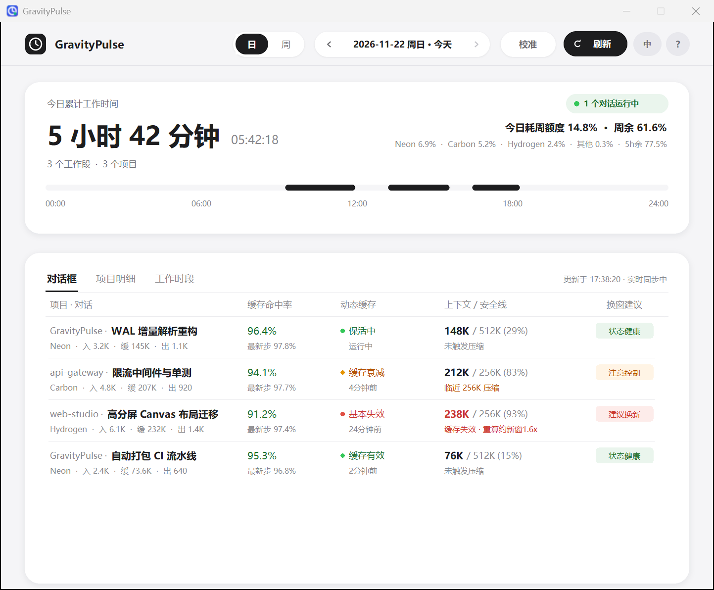
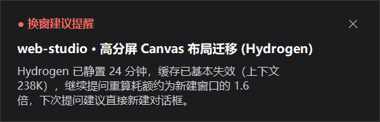

# GravityPulse

[English](README.md) | [简体中文](README_ZH.md)

面向 **Antigravity 2.0** 的桌面监控（Windows / macOS），追踪工时、双滚动额度与 KV 缓存。

高频使用时，很难看出 7 天与 5 小时额度余量，也难判断旧对话缓存是否失效。GravityPulse 只读本地日志，不填 API Key，不上传数据。

- **滚动额度**：对齐官方重置倒计时与 Carbon 3.5x / Neon 1.75x 倍率，按模型与项目拆分消耗。
- **自适应换窗**：按项目学习缓存与冷启动成本，运行中不打扰，仅在停顿或临近压缩时静音提醒。
- **子对话与更新**：缩进展示子代理层级，本地账本留存工时，支持跨端安全更新。

> **免责声明**：GravityPulse 是非官方社区开源工具，仅以只读方式解析 `~/.gemini/antigravity` 下的本地文件。若官方后续调整本地存储结构，可能需要同步适配。

https://github.com/user-attachments/assets/de3b2ad2-3226-4f2c-946d-5a05e1e7ebc7

<p align="center">
  
</p>

<p align="center">
  
</p>

---

## 支持平台与运行边界

- **Windows 10 / 11**：原生系统托盘、无焦点静音提醒（`WS_EX_NOACTIVATE`）、HKCU 伴随自启。
- **macOS 12+（Apple Silicon，Beta）**：原生顶部菜单栏图标（`NSStatusBar`）、Retina 高分屏适配、无焦点浮动提醒、`LaunchAgent` 伴随自启。
- **源码环境**：Python 3.11+（标准库 `tkinter`、`sqlite3`），依赖 `Pillow`（macOS 额外安装 `pyobjc-framework-Cocoa`，均已写入 `requirements.txt`）。

---

## 快速开始

### 方式一：下载安装包（免配 Python）

**Windows**：
1. 前往 [Releases](../../releases) 下载 `GravityPulse-win64.zip`。
2. 解压后双击 `GravityPulse.exe`（未签名包首次启动若出现 SmartScreen 提示，点「更多信息 → 仍要运行」）。
3. 右键系统托盘图标可开关「跟随 Antigravity 开机自启」、创建桌面快捷方式或切换中英文。

**macOS（Apple Silicon，Beta）**：
1. 前往 [Releases](../../releases) 下载 `GravityPulse-macos-arm64.dmg`，打开后将 `GravityPulse.app` 拖入「应用程序（Applications）」。
2. 因开源包未做 Apple 开发者公证，首次打开前在终端执行一次隔离标记清理：
   ```bash
   xattr -cr /Applications/GravityPulse.app
   ```
3. 启动后点击顶部菜单栏时钟图标，即可配置伴随自启（`LaunchAgent`）、创建桌面快捷方式或切换中英文。

### 方式二：源码运行

```bash
git clone https://github.com/aodilab/GravityPulse.git
cd GravityPulse
pip install -r requirements.txt

# 启动或唤醒主面板
python build.py

# 可选：生成图标、创建桌面快捷方式并注册伴随自启
python build.py --setup
```

### 首次额度校准

启动后点击顶栏的额度校准入口，填入 Antigravity 官方 Quota 面板中当前的已用或剩余比例即可。校准配置保存在本地 `data/quota_config.json`，之后会随本地数据持续更新。

---

## 常用命令

| 命令 | 说明 |
| --- | --- |
| `python build.py` | 启动或唤醒 GravityPulse 桌面主窗口 |
| `python build.py --background` | 隐藏主窗口，直接以系统托盘常驻模式启动 |
| `python build.py --watch` | 运行伴随守护进程，检测到 `Antigravity.exe` 启动时自动拉起常驻端 |
| `python build.py --setup` | 生成图标、创建桌面 `GravityPulse.lnk` 快捷方式并写入当前用户自启项 |
| `python build.py --uninstall-startup` | 移除当前用户注册表中的开机伴随自启项 |
| `python build.py --update` | 检查 GitHub Releases 最新版本并安全更新（保留本地 `data/`，源码脏工作区防覆盖） |
| `python build.py --test` | 运行单元测试 |
| `python build.py --audit` | 执行单文件行数检查、语法检查与全部单元测试 |

---

## 本地打包（`.exe` / `.app`）

```bash
pip install pyinstaller
python build.py --icon
pyinstaller --noconfirm --clean packaging/gravitypulse.spec
```

Windows 输出至 `dist/GravityPulse/`，macOS 输出至 `dist/GravityPulse.app`。

---

## 隐私与协议

所有工时与额度数据均在本地只读解析，运行期配置与账本仅保存在本地（Windows 位于程序目录 `data/`，macOS `.app` 位于 `~/Library/Application Support/GravityPulse/`），不上传任何遥测数据。软件仅在检查新版本时访问 GitHub Releases（可在设置中关闭自动检查）。本项目基于 [MIT License](LICENSE) 开源。
